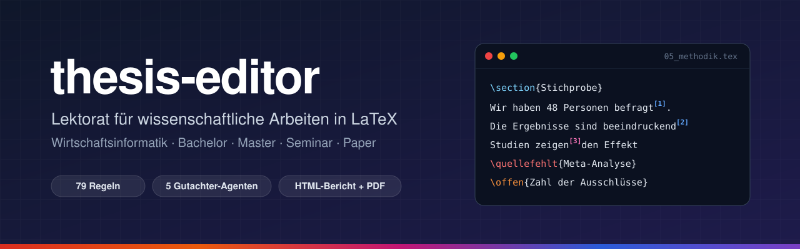

<p align="center">
  
</p>

<p align="center">
  <a href="LICENSE"></a>
  
  
  
  
  
  
  <br>
  <a href="skills/thesis-editor/CHANGELOG.md"></a>
  <a href="skills/code-docs/CHANGELOG.md"></a>
  
</p>

<p align="center">
  <b>Ein Agent-Skill, der deine Abschlussarbeit liest wie Lektorat, Erst- und Zweitgutachten zusammen.</b><br>
  Er markiert, was fehlt oder besser werden kann, und ändert keine einzige Zeile deines Quelltexts.<br>
  Für den praktischen Teil der Arbeit enthält das Repository außerdem <a href="#code-docs">code-docs</a>, das den Code dokumentiert.
</p>

<p align="center">
  <a href="#die-skills">Die Skills</a> ·
  <a href="#installation">Installation</a> ·
  <a href="#aktualisieren">Aktualisieren</a> ·
  <a href="#schnellstart">Schnellstart</a> ·
  <a href="#was-geprüft-wird">Was geprüft wird</a> ·
  <a href="#ergebnisse">Ergebnisse</a> ·
  <a href="#konfiguration">Konfiguration</a> ·
  <a href="#code-docs">code-docs</a> ·
  <a href="#english">English</a>
</p>

---

## Warum

Wer eine Abschlussarbeit schreibt, bekommt Rückmeldung meist spät und verstreut. Am Ende fehlen Quellen, Begriffe wechseln, Wertungen stehen ohne Beleg im Text, und die Forschungsfragen werden im Fazit nicht beantwortet. `thesis-editor` prüft das laufend und nachvollziehbar:

|  | Mechanische Prüfung | Gutachter-Agenten |
|---|---|---|
| **Was** | Typografie, Sprache, Satzbau, Begriffe, Zitation, Bibliografie, Verweise, Verzeichnisse, Formeln | Inhalt, Methodik, Formeln, roter Faden, Quellentreue |
| **Wie** | Python-Skript, gleicher Text ergibt immer dieselben Befunde | fünf Rollen mit festen Prüfaufträgen, laufen parallel |
| **Belegt durch** | Datei, Zeile, Auszug, Regel-ID | Datei, Zeile, wörtlicher Auszug, Regel-ID |

Jeder Befund verweist auf eine Regel mit Begründung, Herkunft und Beispiel. So lässt sich jede Anmerkung prüfen, annehmen oder begründet ablehnen.

## Die Skills

Das Repository enthält zwei Skills, die sich einzeln installieren lassen:

| Skill | Für | Aufruf | Ändert Dateien | Version |
|---|---|---|---|---|
| [thesis-editor](#schnellstart) | Lektorat und Gutachten der schriftlichen Arbeit in LaTeX | `/thesis-editor` oder Bitten wie *„Schau mal über Kapitel 5“* | nein, schreibt nur Berichte nach `.thesis-editor/` | [1.0.0](skills/thesis-editor/CHANGELOG.md) |
| [code-docs](#code-docs) | Dokumentation des praktischen Teils: Docstrings, `ARCHITECTURE.md`, README | nur ausdrücklich mit `/code-docs` | ja, aber nur Docstrings, Kommentare und Dokumentationsdateien | [0.1.0](skills/code-docs/CHANGELOG.md) |

## Installation

Empfohlen ist die Installation für alle Projekte. Dann stehen `/thesis-editor` und `/code-docs` in jedem Ordner zur Verfügung, in dem du den Agenten startest.

```bash
npx skills add whoismarios/scientific-writing-for-german-business-informatics --global
```

Die CLI fragt, welche Skills aus dem Repository installiert werden sollen. Mit `--skill thesis-editor` oder `--skill code-docs` wird nur dieser eine installiert.

Wie bei `npm` gilt: Ohne `--global` installiert die CLI nur in das Projekt, in dem du den Befehl ausführst. Der Skill liegt dann im Projektordner und lässt sich mit dem Projekt teilen.

| Ziel | Befehl | Speicherort bei Claude Code |
|---|---|---|
| für alle Projekte (empfohlen) | `npx skills add whoismarios/scientific-writing-for-german-business-informatics --global` | `~/.claude/skills/<skill>` |
| nur für das aktuelle Projekt | `npx skills add whoismarios/scientific-writing-for-german-business-informatics` | `./.claude/skills/<skill>` |

Ohne weitere Angaben fragt die CLI, für welche Agenten installiert werden soll. Diese Optionen ersetzen die Rückfragen:

| Option | Kurzform | Wirkung | Beispiel |
|---|---|---|---|
| `--global` | `-g` | für alle Projekte des Benutzerkontos statt nur für das aktuelle Projekt | `--global` |
| `--skill <name>` | `-s` | nur diesen Skill installieren, mehrfach angebbar | `--skill code-docs` |
| `--agent <name>` | `-a` | nur für diese Agenten, mehrfach angebbar | `--agent claude-code --agent codex` |
| `--yes` | `-y` | keine Rückfragen, etwa für Skripte | `--yes` |
| `--copy` | | Dateien kopieren statt verlinken | `--copy` |
| `--list` | `-l` | nur anzeigen, was das Repository enthält, nichts installieren | `--list` |

Entfernen:

```bash
npx skills remove thesis-editor code-docs --global
```

<details>
<summary><b>Ohne npx installieren</b></summary>

<br>

Die Ordner unter `skills/` in das Skill-Verzeichnis des Agenten kopieren:

| Agent | für alle Projekte | nur für ein Projekt |
|---|---|---|
| Claude Code | `~/.claude/skills/<skill>` | `.claude/skills/<skill>` |
| Codex | `~/.agents/skills/<skill>` | `.agents/skills/<skill>` |

```bash
git clone https://github.com/whoismarios/scientific-writing-for-german-business-informatics.git
```

```bash
cp -R scientific-writing-for-german-business-informatics/skills/thesis-editor scientific-writing-for-german-business-informatics/skills/code-docs ~/.claude/skills/
```

So installierte Skills aktualisiert `npx skills update` nicht. Für neue Versionen erneut kopieren oder im geklonten Ordner `git pull` ausführen und ihn statt einer Kopie verlinken.

</details>

**Voraussetzungen**

| | Wofür | Pflicht |
|---|---|:---:|
| Python 3.11 oder neuer | Skripte beider Skills, ohne weitere Pakete | ✅ |
| Arbeit in LaTeX | Grundlage aller Prüfungen von `thesis-editor` | ✅ |
| `latexmk` | markierte PDF | ➖ |
| `git` und `gh` | Prüfung der Datensicherung, Update-Prüfung bei privatem Repository | ➖ |
| `npx` (Node.js) | Installation und Updates | ➖ |

## Aktualisieren

Beide Skills schauen selbst nach neuen Versionen. Bei einem Prüflauf fragt das Skript höchstens einmal am Tag auf GitHub nach, ob es eine neuere Version gibt. Ohne Internetverbindung bleibt es still. Gibt es eine, erledigt der Agent zuerst die eigentliche Aufgabe und sagt dann am Ende, welche Version neu ist und was sich geändert hat. Erst nach deinem Ja aktualisiert er, nie mitten in einem Lauf.

Wer das nicht bestätigen will, schaltet das automatische Update ein. Dann lädt der Agent die neue Version am Ende des Laufs und meldet nur noch, dass sie ab dem nächsten Aufruf gilt. Das gilt für ein Projekt über dessen Konfiguration (`thesis-editor.toml` oder `code-docs.toml`):

```toml
[update]
check = true    # nach neuen Versionen schauen
auto = false    # true: ohne Rückfrage am Ende des Laufs aktualisieren
```

Für alle Projekte gleichzeitig gelten diese Umgebungsvariablen:

| Variable | Wirkung |
|---|---|
| `SKILL_AUTO_UPDATE=1` | automatisches Update überall einschalten |
| `SKILL_UPDATE_CHECK=0` | nie nach neuen Versionen schauen |

Von Hand aktualisieren:

```bash
npx skills update thesis-editor code-docs --global
```

Sofort nachsehen, ohne auf den nächsten Prüflauf zu warten:

```bash
python3 ~/.claude/skills/thesis-editor/scripts/update.py --force
```

**Was ein Update nicht anfasst:** Konfiguration, Berichte und Verlauf liegen im Ordner deines Projekts, nicht im Skill, und bleiben erhalten. Konfigurationsschlüssel älterer Versionen funktionieren weiter. Was sich mit jeder Version ändert, steht im Changelog von [thesis-editor](skills/thesis-editor/CHANGELOG.md) und [code-docs](skills/code-docs/CHANGELOG.md). Die Versionen folgen Semantic Versioning: Nur eine neue Hauptversion kann verlangen, dass du etwas anpasst. Neue Regeln können den Lektoratsindex verschieben, das steht dann im Changelog.

Das Ergebnis der Nachfrage merkt sich das Skript einen Tag lang in `~/.cache/scientific-writing-skills/`. Wer den Skill aus einem geklonten Repository verlinkt hat, bekommt statt eines Updates den Hinweis auf `git pull`.

## Schnellstart

Im Ordner der Arbeit den Agenten starten und eingeben:

```text
/thesis-editor
```

Eine Einrichtung ist nicht nötig. Der Skill findet Hauptdatei, Bibliografie, Glossar und vorhandene [Marker-Makros](#marker) selbst. Hinter dem Befehl lässt sich der Umfang angeben:

| Befehl | Umfang | Dauer |
|---|---|---|
| `/thesis-editor` | mechanische Prüfung der ganzen Arbeit | Sekunden |
| `/thesis-editor since HEAD` | nur Absätze, die seit dem letzten Commit geändert wurden | Sekunden |
| `/thesis-editor chapter Methodik` | ein Kapitel, mit Editor und Methodologist oder Mathematician | wenige Minuten |
| `/thesis-editor full` | ganze Arbeit, alle Gutachter, markierte PDF | mehrere Minuten |
| `/thesis-editor submit` | wie `full`, dazu Quellenprüfung und Abgabe-Checkliste | mehrere Minuten |
| `/thesis-editor defense` | Fragenkatalog für das Kolloquium mit Antworten und offenen Flanken | einige Minuten |

Der Skill reagiert auch ohne Befehl auf Bitten wie *„Schau mal über Kapitel 5“*, *„Was habe ich seit gestern geändert?“*, *„Fehlen irgendwo Quellen?“*, *„Ist die Arbeit abgabereif?“* oder *„Was fragen die mich im Kolloquium?“*.

## Was geprüft wird

| Bereich | Regeln | Beispiele |
|---|:---:|---|
| ✍️ Sprache und Ton | 12 | keine Ich- und Wir-Form, keine Wertungen ohne Beleg, keine Floskeln, kein Hedging, Zeitformen |
| 🔤 Typografie | 9 | kein Semikolon, kein Gedankenstrich als Einschub, Zahlen bis zwölf ausgeschrieben, `z.\,B.` |
| 📐 Satzbau | 4 | Satzlänge, Schachtelsätze, Genitivketten, Hauptaussage vorn |
| 🏷️ Begriffe | 7 | feste Begriffe, Synonyme, Komposita mit Bindestrich, Abkürzungen über `\gls` |
| 📚 Zitation | 8 | `\textcite` und `\parencite`, keine manuellen Zitate, Quellentreue |
| 🗂️ Bibliografie | 5 | ungenutzte Einträge, Pflichtfelder, DOI, Dubletten, Preprints |
| 🔗 Formatierung und Verweise | 10 | Abbildungsquelle, `\cref`, Verweis vor dem Objekt, booktabs |
| 🧭 Struktur | 8 | Einleitung je Abschnitt, roter Faden, Doppelungen, Verzeichnisse |
| 🔬 Inhalt und Methodik | 8 | Belegpflicht, Forschungsfragen beantwortet, Setzungen begründet, Limitationen |
| ➗ Formeln | 3 | Variablen erklärt, Rechenbeispiel, einheitliche Notation |
| 🖼️ Abbildungen | 1 | Gestaltung und Lesbarkeit |
| 🛠️ Build-Log | 5 | LaTeX-Fehler, Verweise und Zitate als ??, Zeilen im Rand, biber-Warnungen, jeweils an der Quelltextzeile |
| 💾 Abgabe | 2 | privates Git-Repository, alles committet und gepusht |
| 📌 Marker | 2 | offene Punkte und fehlende Quellen der schreibenden Person |

Alle Regeln mit Begründung und Beispielen stehen in [rules.md](skills/thesis-editor/references/rules.md).

### Die Gutachter

| Rolle | Liest wie | Achtet auf |
|---|---|---|
| 📝 **Editor** | Lektorat | Klarheit, versteckte Wertungen, Zeitformen, Begriffe, Hauptaussage je Absatz |
| 🎓 **Methodologist** | Erstgutachten | Forschungsfragen, Hypothesen, Setzungen, Begründungen, Limitationen |
| ➗ **Mathematician** | Zweitgutachten | Verständlichkeit und Verteidigbarkeit jeder Formel |
| 🧵 **Coherence** | Erstlesende | Zusammenhang, Doppelungen, Zahlenkonsistenz, Detailtiefe |
| 🔎 **Source checker** | Peer Review | ob die zitierte Quelle die Aussage trägt, Belegpflicht |
| 🎤 **Examiner** | Prüfungskommission | wahrscheinliche Fragen im Kolloquium, Stichpunktantworten aus der Arbeit, Lücken |

## Ergebnisse

Alles landet im Ordner `.thesis-editor/` der Arbeit. Er gehört in die `.gitignore`.

| Datei | Inhalt |
|---|---|
| `report.html` | alle Befunde mit Filtern nach Schwere, Art und Quelle, Suche, Anzahl angezeigter Befunde, Lektoratsindex und Verlauf über alle Läufe, hell und dunkel |
| `annotated.pdf` | Kopie der Arbeit mit farbigen Befundnummern, Legende und verlinktem Befundkapitel |
| `defense.html` | Übungsseite fürs Kolloquium: offene Flanken mit kritischen zuerst, Fragen mit Filtern nach Kategorie und Schwierigkeit, Antworten zum Aufklappen, zufällige Reihenfolge, hell und dunkel, druckbar |

Der **Lektoratsindex** zählt Fehler fünffach, Warnungen doppelt und Hinweise halb, je 1.000 Wörter. Niedriger ist besser. Über den Verlauf wird sichtbar, was behoben wurde und was neu ist.

| Farbe | Bedeutung |
|---|---|
|  Rot | Quelle fehlt, Marker `\quellefehlt{...}` |
|  Orange | offener Punkt, Marker `\offen{...}` |
|  Magenta | Beleg prüfen |
|  Blau | Sprache und Typografie |
|  Violett | Struktur, Verweise, Inhalt |

## Konfiguration

Optional. Wer Begriffe, Forschungsfragen oder eigene Regeln festlegen will, legt im Ordner der Arbeit eine Konfiguration an:

```bash
python3 ~/.claude/skills/thesis-editor/scripts/cli.py init
```

```toml
project_rules = ["Jede Modellwahl wird mit Kosten und Qualität begründet."]

[terms]
compounds = ["KI-Assistent"]
variants = [["Nutzer|Nutzers|Nutzern", "Anwender|Anwendern"]]

[terms.forbidden]
"Webseite*" = "Website"

[research_questions]
FF1 = "Wie wirkt sich X auf Y aus?"
```

### Marker

Was beim Schreiben noch fehlt, wird direkt im Text markiert, statt es im Kopf zu behalten. Der Skill sammelt diese Marker als offene Punkte im Bericht, zählt sie aber nicht als Befund. Vor der Abgabe sollte keiner mehr übrig sein. Die beiden Makros gehören in die Präambel:

```latex
\usepackage{xcolor}
\newcommand{\quellefehlt}[1]{\textcolor{red}{[Quelle fehlt: #1]}}
\newcommand{\offen}[1]{\textcolor{orange!85!black}{[Offen: #1]}}
```

```latex
Die Akzeptanz steigt mit dem wahrgenommenen Nutzen \quellefehlt{Davis 1989}.
\offen{Stichprobengröße nach der Erhebung eintragen.}
```

Im PDF erscheinen beide farbig, sodass nichts übersehen wird. Wer andere Makronamen verwendet, trägt sie in der Konfiguration unter `[markers]` ein. Die Prüfung meldet in ihrer Zusammenfassung, ob die erwarteten Makros definiert sind. Der Skill schlägt `\quellefehlt` nur vor, wenn das Makro existiert, sonst würde LaTeX abbrechen.

Alle Optionen mit Kommentaren stehen in [thesis-editor.example.toml](skills/thesis-editor/thesis-editor.example.toml). Ein Befund, der bewusst so bleiben soll, wird im Quelltext ausgenommen:

```latex
Die Werte liegen zwischen 1 und 5. % thesis-editor: ignore TYP-ZAHLWORT
```

<details>
<summary><b>Kommandozeile ohne Agent</b></summary>

<br>

Die mechanische Prüfung läuft auch ohne Agent:

```bash
python3 ~/.claude/skills/thesis-editor/scripts/cli.py check
```

| Befehl | Wirkung |
|---|---|
| `init` | legt `thesis-editor.toml` mit erkannten Werten an |
| `check` | mechanische Prüfung und Auswertung des letzten LaTeX-Logs |
| `context` | Gliederung, Wortzahlen, Formeln, Marker und Projektregeln für die Gutachter |
| `report` | `report.html` und ein Verlaufseintrag je Prüflauf |
| `annotate` | `annotated.pdf` |
| `defense` | erzeugt `defense.html` aus den Fragen des Examiners |
| `clean` | entfernt Befunde und Fragen älterer Agentenläufe |
| `rules` | erzeugt `references/rules.md` aus `rules.toml` |

| Option | Kurzform | Befehl | Wirkung | Beispiel |
|---|---|---|---|---|
| `--since <rev>` | `-s` | `check` | nur Absätze, die seit dieser Git-Revision geändert wurden, auch neue Dateien | `check --since HEAD~1` |
| `--only <regex>` | `-o` | `check` | nur Dateien, deren Pfad passt, samt eingebundener Dateien | `check --only 03_methodik` |
| `--force` | `-f` | `init` | vorhandene Konfiguration überschreiben | `init --force` |
| `--no-history` | | `report` | Bericht ohne Verlaufseintrag, etwa für Zwischenstände | `report --no-history` |
| `--no-build` | | `annotate` | markierte Kopie vorbereiten, aber nicht kompilieren | `annotate --no-build` |
| `--root <pfad>` | | alle | Projektwurzel, Standard ist das aktuelle Verzeichnis | `check --root ~/thesis` |
| `--help` | `-h` | alle | Hilfe zum Befehl | `check --help` |

</details>

## code-docs

Der zweite Skill im Repository dokumentiert den Code einer Arbeit oder eines beliebigen Projekts. Python, TypeScript und JavaScript prüft er mechanisch, für Java, C#, R und Go schreibt er die Dokumentation nach der jeweiligen Konvention ohne mechanische Prüfung. Er ändert nur Docstrings, Kommentare und Dokumentationsdateien, nie die Programmlogik.

| Ebene | Ort | Inhalt |
|---|---|---|
| Docstrings | an jeder öffentlichen Funktion und Klasse | Einzeiler, Parameter und Rückgabewert nach den Google Style Guides, in Python als Docstring, in TypeScript und JavaScript als JSDoc |
| `ARCHITECTURE.md` | Projektwurzel | Module, Datenfluss, Grenzen und wo man mit dem Lesen anfängt |
| `README.md` | Projektwurzel | Zweck, Voraussetzungen, Einrichtung, Umgebungsvariablen, Start, Tests |

```text
/code-docs
```

| Befehl | Wirkung |
|---|---|
| `/code-docs` | prüft und fasst die Lücken zusammen, ändert nichts |
| `/code-docs docstrings <pfad>` | dokumentiert Funktionen und Klassen in dieser Datei oder diesem Ordner |
| `/code-docs architecture` | schreibt oder aktualisiert `ARCHITECTURE.md` |
| `/code-docs readme` | gleicht die README mit dem Code ab |
| `/code-docs all` | alle drei Schritte nacheinander |

Ein Skript findet die mechanischen Lücken: fehlende Docstrings, dokumentierte Parameter, die es nicht mehr gibt, Befehle in der README ohne passendes Skript, Pfade, die nicht existieren, und Umgebungsvariablen aus `.env.example`, die nirgends beschrieben sind. Den Text schreibt der Agent, nachdem er den Code gelesen hat.

### Grundlage

Damit sich nachvollziehen lässt, wie der Code dokumentiert ist, folgt der Skill veröffentlichten Standards. Jede Regel nennt ihre Quelle, `check.py --rules` listet sie auf.

| Ebene | Standard |
|---|---|
| Python | [Google Python Style Guide](https://google.github.io/styleguide/pyguide.html#s3.8-comments-and-docstrings), Abschnitt 3.8, aufbauend auf [PEP 257](https://peps.python.org/pep-0257/) |
| TypeScript | [Google TypeScript Style Guide](https://google.github.io/styleguide/tsguide.html#comments-documentation), Abschnitt „Comments and documentation“, Tags nach [JSDoc](https://jsdoc.app/) und [TSDoc](https://tsdoc.org/) |
| JavaScript | [Google JavaScript Style Guide](https://google.github.io/styleguide/jsguide.html#jsdoc), Abschnitt 7 „JSDoc“ |
| Java | [Google Java Style Guide](https://google.github.io/styleguide/javaguide.html#s7-javadoc), Abschnitt 7 „Javadoc“, Formulierung nach [Oracle](https://www.oracle.com/technical-resources/articles/java/javadoc-tool.html) |
| C# | Microsoft, [XML documentation comments](https://learn.microsoft.com/en-us/dotnet/csharp/language-reference/xmldoc/) |
| R | [roxygen2](https://roxygen2.r-lib.org/articles/rd.html) und [Tidyverse style guide](https://style.tidyverse.org/documentation.html), Kapitel 7 |
| Go | [Go Doc Comments](https://go.dev/doc/comment) |
| `ARCHITECTURE.md` | Kladov (2021), [ARCHITECTURE.md](https://matklad.github.io/2021/02/06/ARCHITECTURE.md.html) |
| README | [Standard Readme](https://github.com/RichardLitt/standard-readme) und GitHub, [About READMEs](https://docs.github.com/en/repositories/managing-your-repositorys-settings-and-features/customizing-your-repository/about-readmes) |

In der Arbeit lässt sich das so belegen: *„Die Dokumentation des Quellcodes folgt dem Google Python Style Guide (Abschnitt 3.8) und dem Google TypeScript Style Guide.“* Die Style Guides haben keine Versionsnummern, deshalb gehört das Abrufdatum in das Literaturverzeichnis. Wo der Skill von den Guides abweicht, steht mit Begründung in der [SKILL.md](skills/code-docs/SKILL.md) unter *Standards and sources*.

### Stil und Konfiguration

Regeln des Projekts haben Vorrang. Steht in `AGENTS.md`, `CLAUDE.md` oder der Linter-Konfiguration etwas anderes, etwa nur Einzeiler, folgt der Skill dem Projekt. Der Stil lässt sich in einer `code-docs.toml` festlegen:

| `style` | Verlangt | Grundlage |
|---|---|---|
| `google` (Standard) | Einzeiler genügt, wenn Name und Signatur alles sagen. Sonst Parameter und Rückgabewert | wie in den Google Style Guides |
| `full` | Einzeiler, alle Parameter und Rückgabewert an jeder öffentlichen Funktion | strenger als die Guides, als Hausregel |
| `summary` | nur ein Docstring, ohne Parameter und Rückgabewert | lockerer als die Guides |

```toml
style = "google"
private = false    # auch _private Funktionen dokumentieren
min_lines = 0      # kürzere Funktionen auslassen
exclude = ["*/generated/*"]
```

Die Prüfung läuft auch ohne Agent:

```bash
python3 ~/.claude/skills/code-docs/scripts/check.py .
```

| Option | Wirkung | Beispiel |
|---|---|---|
| `--only <bereiche>` | nur `code`, `readme` oder `arch`, kommagetrennt | `--only readme` |
| `--since <rev>` | nur Code, der seit dieser Git-Revision geändert wurde | `--since HEAD~1` |
| `--json` | Befunde als JSON | `--json` |
| `--rules` | alle Regeln mit Schwere und Quelle | `--rules` |

Voraussetzung ist Python 3.11 oder neuer. Mechanisch geprüft werden Python, TypeScript und JavaScript. Dateien in Java, C#, R und Go zählt die Prüfung unter „not checked mechanically“ auf, damit sichtbar bleibt, was nur von Hand dokumentiert wurde.

## Mitwirken

Neue Regeln sind willkommen. Jede Regel steht in [rules.toml](skills/thesis-editor/rules.toml), und jede mechanische Regel braucht einen Testfall mit `% expect: REGEL-ID` in `skills/thesis-editor/evals/fixture/`.

```bash
python3 skills/thesis-editor/scripts/cli.py rules
```

```bash
python3 skills/thesis-editor/evals/run_evals.py
```

Für `code-docs` stehen die Testfälle als `expect: REGEL-ID` in Kommentaren unter `skills/code-docs/evals/fixture/`. `expect-full:` gilt nur für den Stil `full`, das Skript prüft beide Stile:

```bash
python3 skills/code-docs/evals/run_evals.py
```

Eine Änderung ist fertig, wenn alle Testfälle weiter durchlaufen.

Jede Veröffentlichung erhöht die Version in der Datei `VERSION` des Skills und bekommt einen Eintrag in dessen `CHANGELOG.md`. Erst dadurch sehen Nutzer das Update. Korrekturen erhöhen die letzte Stelle, neue Regeln und Funktionen die mittlere, Änderungen, die Nutzer zum Anpassen zwingen, die erste. Umbenannte Konfigurationsschlüssel bleiben als alte Namen lesbar. Jede Version bekommt im Repository einen Tag nach dem Muster `<skill>-vX.Y.Z`, etwa `thesis-editor-v1.0.0`, damit sich ein Stand eindeutig zitieren lässt. Das Skript zeigt je Regel erwartete, fehlende und unerwartete Treffer.

Skill, Befehle, Optionen, Konfigurationsschlüssel und Dateinamen sind englisch. Regeln, Meldungen und Berichte sind deutsch, weil sie deutsche Texte prüfen und von der schreibenden Person gelesen werden.

## English

`thesis-editor` is an agent skill for Claude Code, Codex and other agents that reviews German academic writing in LaTeX, tailored to business informatics (Wirtschaftsinformatik). A deterministic linter checks typography, language, citations, bibliography, cross-references, lists of figures and tables, the LaTeX build log, and whether the work is safely versioned in Git. Five reviewer agents check content, method, formulas, coherence and whether sources support the claims. The result is an HTML report with history and an annotated PDF. The source is never modified.

```bash
npx skills add whoismarios/scientific-writing-for-german-business-informatics --global
```

Both skills check GitHub at most once a day for a newer version, report it at the end of a run and update after confirmation, or automatically with `auto = true` under `[update]` or `SKILL_AUTO_UPDATE=1`. Changes are listed in each skill's `CHANGELOG.md`.

Run `/thesis-editor` inside your thesis folder, optionally followed by `chapter <name>`, `since <rev>`, `full`, `submit` or `defense` (question catalogue for the oral defense). The check also reads the LaTeX and biber logs of the last build. Commands, flags and config keys are English. Rules, findings and reports are German.

The repository also contains `code-docs`, a skill that documents code following published style guides (Google for Python, TypeScript, JavaScript and Java, Microsoft for C#, roxygen2 for R, Go Doc Comments), with a mechanical check for Python, TypeScript and JavaScript: docstrings and JSDoc with summary, parameters and return value, an `ARCHITECTURE.md`, and a README whose commands, paths and environment variables match the project. It only changes documentation, never program logic. Install it alone with `--skill code-docs` and run `/code-docs`.

## Lizenz

[MIT](LICENSE) © 2026 Marios Tzialidis
